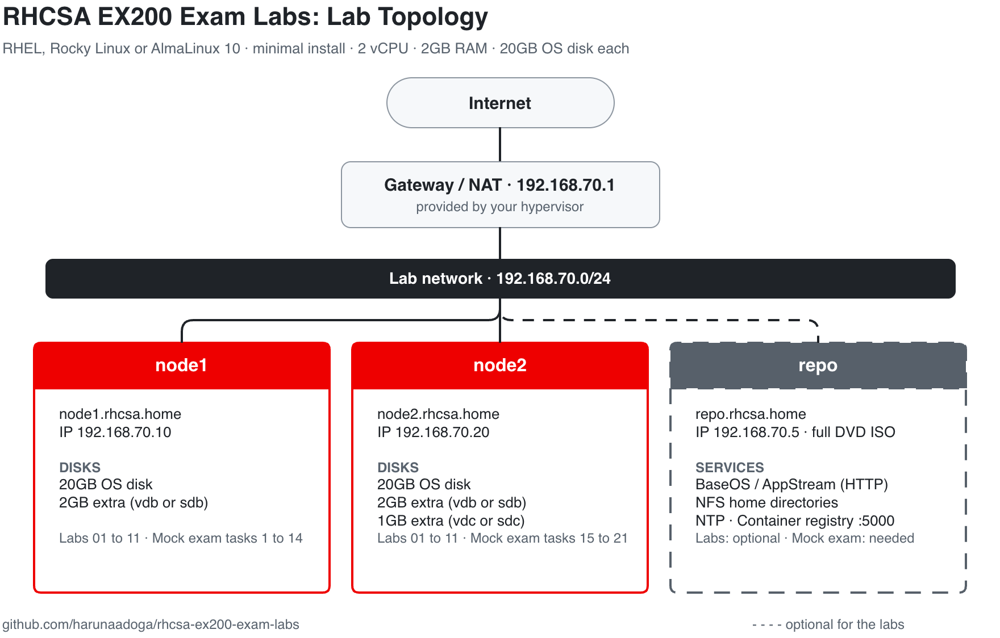

# Lab Setup

Used for the objective labs and the mock exam.



## Before You Start

New to virtual machines? This section covers what you need.

### A computer

- **RAM:** each VM uses 2GB. The labs need 2 VMs (4GB), the mock exam needs 3 (6GB), plus what your computer itself uses. 16GB is comfortable, 8GB is enough for the labs.
- **Free disk space:** about 70GB.

### A hypervisor

A hypervisor is software that runs virtual machines (VMs) on your computer. Pick one for your computer. All are free.

| Your computer | Hypervisor |
|---------------|------------|
| Windows | [VirtualBox](https://www.virtualbox.org/wiki/Downloads) or VMware Workstation |
| Linux | [VirtualBox](https://www.virtualbox.org/wiki/Downloads), VMware Workstation or virt-manager (KVM) |
| Intel Mac | [VirtualBox](https://www.virtualbox.org/wiki/Downloads) or VMware Fusion |
| Apple Silicon Mac (M1 or newer) | [UTM](https://mac.getutm.app/) or VMware Fusion |
| A home server | [Proxmox VE](https://www.proxmox.com/en/downloads) |

### An ISO

The installer image for the OS. Download the **DVD ISO** of RHEL 10, Rocky Linux 10 or AlmaLinux 10 (links in [Resources](../docs/resources.md)).

- Most computers: the **x86_64** ISO
- Apple Silicon Mac: the **aarch64** (ARM) ISO

Use the same ISO for all VMs.

## 1. Create the Lab Network

Don't put the lab on your home network. Create a separate virtual network in your hypervisor, so the lab gets its own fixed addresses and stays off your home devices.

Create a **NAT network** with:

- **Network:** `192.168.70.0/24`
- **DHCP:** off, since the VMs use fixed IPs

Then note the network's **gateway address**. Most hypervisors use `192.168.70.1`. VMware may use a different one, so check its NAT settings. Use your gateway wherever this guide says `192.168.70.1`.

Where to find it (menu names vary slightly between versions):

- **VirtualBox:** Network Manager > NAT Networks > Create. Set each VM's network adapter to **NAT Network**.
- **VMware Workstation:** Edit > Virtual Network Editor > Add Network, type **NAT**, subnet `192.168.70.0`, mask `255.255.255.0`. Check the gateway under NAT Settings.
- **UTM:** set each VM's Network Mode to **Shared Network**, and set **Guest Network** to `192.168.70.0/24` under advanced settings.
- **virt-manager:** Edit > Connection Details > Virtual Networks > **+**, mode **NAT**.
- **Proxmox:** create a Linux bridge (for example `vmbr1`) with address `192.168.70.1/24` and NAT (masquerade) to your main bridge. Attach the VMs to it.

## 2. Create the VMs

| VM | IP | Extra disks |
|----|----|-------------|
| node1 | 192.168.70.10 | one 2GB disk |
| node2 | 192.168.70.20 | one 2GB disk and one 1GB disk |
| repo (optional for labs, needed for mock exam) | 192.168.70.5 | none, but keep the DVD ISO attached |

For each VM:

- **Install:** minimal install, 2 vCPU, 2GB RAM, 20GB disk. Set a root password.
- **Network:** attach it to the lab network. During install, set the IP from the table, netmask `255.255.255.0` (`/24`), gateway `192.168.70.1` and DNS `1.1.1.1`.
- **Extra disks:** add them in the hypervisor's VM settings. Inside the VM they show up as `/dev/vdb` and `/dev/vdc`, or `/dev/sdb` and `/dev/sdc`, depending on the hypervisor. Check with `lsblk`.

## 3. Prepare node1 and node2

Log in as root on **both** node1 and node2 and run:

```bash
cat >> /etc/hosts << 'EOF'
192.168.70.5   repo.rhcsa.home repo
192.168.70.10  node1.rhcsa.home node1
192.168.70.20  node2.rhcsa.home node2
EOF

useradd -G wheel hadoga
passwd hadoga
```

## 4. Set Up the Repo VM

Needed for labs 05 and 10, and for the mock exam. Log in as root on the repo VM and run:

```bash
curl -O https://raw.githubusercontent.com/harunaadoga/rhcsa-ex200-exam-labs/main/mock-exam/setup-repo.sh
bash setup-repo.sh
```

It prints `repo server ready` when it's done.

## 5. Snapshot node1 and node2

A snapshot saves a VM's current state so you can go back to it later. Take one of node1 and node2 and name it `clean`. You can now start the objective labs.

## 6. Mock Exam Only

Revert node1 and node2 to `clean`, then run as root:

```bash
# on node1
curl -O https://raw.githubusercontent.com/harunaadoga/rhcsa-ex200-exam-labs/main/mock-exam/prep-node1.sh
bash prep-node1.sh

# on node2
curl -O https://raw.githubusercontent.com/harunaadoga/rhcsa-ex200-exam-labs/main/mock-exam/prep-node2.sh
bash prep-node2.sh
```

Then open the [exam](./exam.md), start a 3 hour timer, and use the VM consoles.